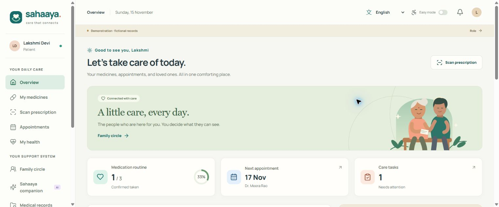

# SAHAAYA

**Your Health. Your Family. Always Connected.**

Created by **BanuSreya**.

An elderly-first care coordination application with a real PostgreSQL backend, patient-controlled family access, verified medication schedules and an independent follow-up worker. Supports English, Telugu, Tamil, Hindi, Kannada and Malayalam.

**[Open SAHAAYA](https://sahaaya-mauve.vercel.app) · [Try the fictional demo](https://sahaaya-mauve.vercel.app/demo) · [Judge's three-minute walkthrough](docs/JUDGES_GUIDE.md)**

[](https://github.com/BANU-09/sahaaya/actions/workflows/ci.yml)



## The problem and our approach

An older adult's medicines, paper records and appointments often sit in separate places. Family members cannot tell whether a reminder was seen, whether a dose was confirmed, or who is following up. SAHAAYA connects these steps with patient-controlled access: **read → review → schedule → confirm → follow up together**. An unconfirmed dose stays unconfirmed; the software never invents adherence.

The public deployment uses free Vercel hosting, Neon PostgreSQL and a Cloudflare scheduled worker. No paid Google services are enabled. On-device machine-learning OCR provides private document transcription; medication changes always require human review and approval.

## What works

- Password accounts, authenticator MFA/recovery codes, fresh-authenticated data export/account deletion, session-bound PIN, device session revocation, and consented family/caregiver/verified-doctor invitations.
- Image/PDF upload → private on-device transcription → field-by-field review. Medicine entry remains an explicit reviewed draft → approval → scheduled doses. A labelled fictional prescription sample demonstrates the complete medicine workflow; optional cloud adapters are inactive.
- Daily/weekday/alternate-day/finite-course/as-needed medicines, confirmation, snooze, help requests, witnessed caregiver recording, refills and archive history.
- An independent Care Loop creates due/follow-up/escalated alerts and tracks human acknowledgement/resolution. Unconfirmed does not mean missed.
- Appointments, family synchronization, tasks, journal, vitals, adherence trends, private documents, patient-approved printable visit summaries and expiring/revocable Emergency Passport QR links.
- A companion answers from authorized saved records. Optional Gemini classifies question intent; source records supply the answer. Voice uses available browser capabilities.
- Authenticated iCalendar downloads for appointments, with stable event IDs, cancellation state and no patient names or clinical details. Import the file into Google, Apple or Outlook Calendar; this is an explicit export, not automatic sync.
- Free Google Maps links for hospital search and appointment directions. No API key is required; patient records are not included in search links.
- Optional GCS, Google Calendar/Places, Firebase, Resend and Brevo adapters with explicit unavailable/error states. Settings distinguishes the actual active storage and notification providers from optional Google services.
- On-device image/PDF OCR for prescriptions, reports, discharge notes, appointment slips and packaging; editable, field-by-field reviewed transcripts with original-document provenance.
- Versioned document metadata, recipient-acknowledged caregiver handovers, custom date-range adherence heatmaps/vital trends, reviewed companion drafts, and operator-gated doctor applications.
- Standard Web Push with generated VAPID credentials, delivery receipts and expired-subscription cleanup. Personal accounts can send a generic self-test and see provider acceptance separately from a browser receipt. Shared demo accounts cannot send external notifications. The Resend webhook adapter verifies signatures and deduplicates callbacks.

See [QUALITY_REPORT.md](QUALITY_REPORT.md) for measured results and limits: **126 unit tests across 16 files and 38 browser/API journeys passed locally**, with zero serious/critical axe violations on the tested screens. The release evidence and CI identify which source was tested. These are measured checks, not a hackathon score. Cloud AI, email/SMS, Google OAuth/Calendar API/Places API and live clinic booking are not active in the free deployment. Calendar-file export and Google Maps links do not depend on those APIs. Browser notification delivery requires permission and a supported browser. This project does not claim clinical or compliance certification.

## Start locally

Requires Node.js 22.12+ (tested with 26.1.0) and npm. The included development helper runs native PostgreSQL in `.data/postgres`, bound to loopback. A managed/existing PostgreSQL DATABASE_URL can be used instead; skip the local DB command in that case.

```powershell
git clone https://github.com/BANU-09/sahaaya.git
cd sahaaya
npm ci
Copy-Item .env.example .env
```

Choose a unique password in the example DATABASE_URL before the first local initialization. Keep its host/port/database as `127.0.0.1:54329/sahaaya`. Set APP_URL to `http://127.0.0.1:3100` and DEMO_MODE to `true`. Generate a persistent 32-byte base64 key with `node -e "console.log(require('node:crypto').randomBytes(32).toString('base64'))"` and store it privately as TOKEN_ENCRYPTION_KEY. If a private `.env` already exists, preserve it when resuming.

Run `npm run db:local` and keep that terminal open. In another terminal:

```powershell
npx prisma generate
npm run db:migrate
npm run db:seed
npm run dev
```

Run `npm run worker` in a separate terminal in the same directory. Open [Sahaaya](http://127.0.0.1:3100), choose Explore demo and a role. Fictional records are shared across demo sessions; normal accounts remain isolated. Do not enter real health information in the public demo. Settings includes a labelled demo reset control; Family includes a labelled escalation simulation.

Register as Patient for your own profile. Family/Caregiver accounts accept patient-issued invitations. Google-only accounts can create their own patient profile after consent or accept an invitation. Doctor status requires operator verification.

## Verification

```powershell
npm run typecheck
npm run lint
npm run format:check
npm run test:coverage
npm run build
npm run start -- --port 3100
# In another terminal:
npm run test:e2e
```

Tests use installed Google Chrome. Alternatively run `npx playwright install chromium` and set PLAYWRIGHT_BROWSER to `chromium`. Use a **disposable local database**, DEMO_MODE=true, external notifications disabled and the origin above. Tests create unique `@example.invalid` accounts and clean them afterward; browser journeys reset fictional demo records. Do not run against real patients or concurrently with a worker while API tests deliberately advance scheduler time.

Evidence: `coverage/index.html`, `coverage/coverage-summary.json`, `playwright-report/index.html`, `test-results/results.json` and screenshots. Final evidence is copied to `docs/evidence`. The measured modules are listed in `vitest.config.ts` and the release summary; this is not whole-product coverage or a hackathon score.

## Documentation

- [Architecture and API](docs/ARCHITECTURE.md)
- [Integrations and deployment](docs/INTEGRATIONS_AND_DEPLOYMENT.md)
- [Remaining provider setup and credential handoff](docs/PROVIDER_HANDOFF.md)
- [Quality report](QUALITY_REPORT.md)
- [Requirement traceability and gaps](docs/REQUIREMENTS.md)
- [Original requested scope](docs/MASTER_BRIEF.md)

The free production setup uses Vercel web functions, Neon, encrypted database-backed documents (3 MB/file, 200 MB total raw file quota) and a Cloudflare worker every ten minutes. Free quotas may pause service; this is a hackathon demonstration, not an emergency or clinical monitoring service. The standalone worker/GCS adapters remain available for separately provisioned deployments. Never commit medical records, credentials or `.env`.
