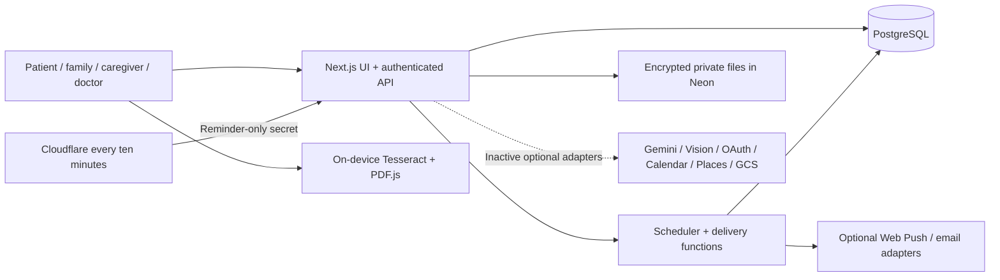

# Architecture and API

Next.js App Router serves the React interface and Node API. PostgreSQL/Prisma persists every care operation. A separate scheduler handles escalation without a browser. Visible dashboards poll authorized records every 15 seconds.

## Code map and model

`src/app` contains routes/styles; `src/components` contains feature screens/accessible controls; `src/lib` holds validation, permissions, localization and schedule math. Business operations are in `src/server/services`, providers in `src/server/integrations`. `prisma/schema.prisma` and versioned SQL migrations are the database source of truth. `scripts/worker.ts` is independently deployable.

The API dispatcher delegates account/profile settings, care tasks and observations, and emergency operations to `profile-settings.ts`, `care.ts` and `emergency.ts`. Each service retains authorization and validation close to its database operation. Provider HTTP timeout/error handling is shared in `integrations/http.ts`; email provider selection is isolated in `integrations/email.ts`.

Mutation route validation rejects missing resource IDs before passing data to Prisma. This prevents absent identifiers from broadening item updates/deletes. Account preferences update atomically. Companion intent routing lives separately in `src/lib/companion-intent.ts`; language-independent shortcut IDs avoid relying on translated UI text to select an operation.

A User owns at most one Patient and joins CareCircles through Membership and explicit Permission rows. Each request checks active, non-revoked membership and the required permission. Patient ownership is additionally required for invitations, permission changes, emergency links and summary approval. Doctor invitations require a verified Doctor row. Demo identities cannot access real patients.

Medication has MedicationSchedule, ScheduledDose, immutable DoseEvent, Refill and optional Prescription → Document provenance. Drafts generate no doses. Approval and the worker create an eight-day rolling schedule. Confirmation uses a version guard and transaction; stock deducts only confirmed consumption. As-needed records require explicit verification and a replay-protection request ID. Active prescriptions cannot be silently edited; create a new reviewed draft and archive the superseded regimen.

CareAlert stores escalation separately from dose truth. Acknowledgement does not mark a dose taken or missed. Notification event keys are unique. AVAILABLE is an in-app state; ACCEPTED means provider acceptance, not delivery. PostgreSQL advisory locking serializes scheduler passes; cursor batches of 200 avoid truncating the eligible population. Delivery workers atomically claim 50 jobs, respect recipient quiet hours and retry up to five times. A full scheduling transaction has a 60-second deadline and requires load testing before scale-up.

Appointments preserve request/confirmed/completed/cancelled state; confirmation needs an actual external reference. There is no hospital booking contract. Private documents, journal/vitals, tasks, approved summaries, expiring EmergencyShare, AuditLog, encrypted GoogleAccount, Session, RecoveryToken and WorkerHeartbeat complete the model.

## API

All endpoints are under `/api`. JSON writes require application/json and Origin matching APP_URL. Errors return `{ "error": "localizedKey" }`: 400 input, 401 authentication, 403 permission/consent/origin, 404 missing, 409 conflict, 413 size, 415 media, 423 locked, 429 rate limit, 502 upstream rejection, 503 unavailable. APIs/files use no-store.

| Endpoint                                           | Methods            | Purpose                                                            |
| -------------------------------------------------- | ------------------ | ------------------------------------------------------------------ |
| `/health`, `/config`                               | GET                | DB/worker health; configured flags, no secrets                     |
| `/auth/register`, `/auth/login`, `/auth/logout`    | POST               | Identity/session                                                   |
| `/auth/demo`, `/auth/lock`, `/auth/unlock`         | POST               | Demo; device-bound PIN lock                                        |
| `/auth/recover`, `/auth/reset`                     | POST               | Email recovery, single-use token                                   |
| `/auth/google/start`, `/auth/google/callback`      | GET                | OAuth state/nonce/PKCE                                             |
| `/onboarding`                                      | POST               | Consented self patient profile                                     |
| `/me`, `/settings`                                 | GET                | Account, memberships, preferences, sessions                        |
| `/settings`, `/sessions/:id`                       | PATCH, DELETE      | Preferences/PIN; revoke session                                    |
| `/invitations`                                     | POST               | Accept email-bound invitation                                      |
| `/notifications`, `/notifications/:id`             | GET, PATCH         | Inbox/read acknowledgement                                         |
| `/push`                                            | GET/POST/DELETE    | Public web config; device subscription                             |
| `/patients/:p/dashboard`, `/analytics?days=7`      | GET                | Permission-filtered dashboard; 1–366-day/custom-date analytics     |
| `/patients/:p/medications`                         | POST               | Create draft                                                       |
| `/patients/:p/medications/:id`                     | PATCH/DELETE       | Edit draft; archive                                                |
| `/patients/:p/medications/:id/approve`             | POST               | `{verified:true}`                                                  |
| `/patients/:p/medications/:id/refill`              | POST               | `{quantity:30}`                                                    |
| `/patients/:p/medications/:id/prn`                 | POST               | UUID requestId, verified, optional witnessed/reason                |
| `/patients/:p/doses/:id`                           | POST               | TAKEN/SNOOZED/NOT_TAKEN/HELP                                       |
| `/patients/:p/appointments`, `/appointments/:id`   | POST, PATCH        | Create/update                                                      |
| `/patients/:p/appointments/:id/calendar`           | POST               | Explicit calendar sync                                             |
| `/patients/:p/appointments/:id/calendar.ics`       | GET                | Authorized private calendar download; generic title and times only |
| `/patients/:p/invitations`, `/members/:id`         | POST, PATCH/DELETE | Owner consent/access                                               |
| `/patients/:p/journal`, `/vitals`                  | POST               | Mood/symptoms, manual observations                                 |
| `/patients/:p/tasks`, `/tasks/:id`, `/alerts/:id`  | POST, PATCH, PATCH | Assign/complete; acknowledge/resolve                               |
| `/patients/:p/documents`                           | GET/POST multipart | Paginated search; JPEG/PNG/PDF ≤3 MiB                              |
| `/patients/:p/documents/:id`                       | GET                | Protected attachment download                                      |
| `/patients/:p/scan`                                | POST               | documentId+consent or explicit demo sample                         |
| `/patients/:p/companion`                           | POST               | question+optional useAI                                            |
| `/patients/:p/summaries`, `/summaries/:id`         | POST, GET/PATCH    | Create, read, patient approval                                     |
| `/patients/:p/profile`, `/audit`                   | GET/PATCH, GET     | Emergency profile, paginated audit                                 |
| `/patients/:p/emergency-share`, `/passport/:token` | POST/DELETE, GET   | One-hour revocable bearer link                                     |
| `/demo/reset`, `/demo/simulate`                    | POST               | Labelled fictional scenarios                                       |

Payload schemas: `src/lib/validation.ts`; executable examples: `tests/e2e/api.spec.ts`.

Additional authenticated endpoints:

| Endpoint                                             | Methods             | Purpose                                                                                       |
| ---------------------------------------------------- | ------------------- | --------------------------------------------------------------------------------------------- |
| `/auth/mfa`, `/security/:action`                     | POST                | Pending-login second factor, enrollment, one-use recovery, email verification when configured |
| `/privacy/export`, `/privacy/delete`                 | POST                | Fresh-authenticated data access and explicit account deletion                                 |
| `/doctor-profile`, `/operator/doctors/:id`           | GET/POST, GET/PATCH | Professional application and operator-gated review                                            |
| `/patients/:p/handovers/:id`                         | GET/POST/PATCH      | Shared-scope handover and recipient acknowledgement                                           |
| `/patients/:p/documents/:id/history`, `/extractions` | GET, POST/PATCH     | Metadata history, source-linked transcription and explicit verification                       |
| `/patients/:p/companion-drafts/:id`                  | POST                | Create an expiring draft, then explicitly commit once                                         |
| `/push/receipt`                                      | POST                | Authenticated notification recipient's device receipt                                         |
| `/push/test`, `/push/test/:id`                       | POST, GET           | Personal-account self-test and owner-only acceptance/receipt status                           |
| `/webhooks/resend`                                   | POST                | Bounded raw body, Svix signature verification, deduplication and ordered terminal states      |
| `/internal/worker`                                   | POST                | Constant-time reminder-secret authentication; scheduler, dispatch and file cleanup            |

## Security and limits

Salted scrypt passwords/PINs; hashed session/share/invitation/reset tokens; HttpOnly SameSite=Lax cookies, Secure for HTTPS; AES-256-GCM OAuth token encryption; no private service-worker cache; server-side permissions and rate limits; MIME signatures and bounded inputs; PHI-free routine error logs. Active grants/revocation are checked per request.

Authenticator MFA with atomic time-step replay protection, one-use recovery codes, QR enrollment and fresh-authenticated export/deletion are implemented. Email verification is available only with an activated sender; mobile verification is not implemented. JSON and signed webhook bodies have streaming byte limits. Document metadata is versioned; transcription drafts retain original provenance. Reviewed companion drafts recheck ownership, permissions and expiry at commit. Care handovers expose only the sender/recipient's shared permissions.

The free Vercel deployment executes scheduler/delivery functions through a protected endpoint called by Cloudflare. A standalone worker remains supported for conventional hosting. VAPID web push supports standard browsers; receipt states remain separate from provider acceptance. Background delivery rechecks membership, permissions and doctor verification.

Remaining operational work includes malware scanning, retention ownership, a nonce-based CSP (inline Next scripts/styles currently allowed), managed-PostgreSQL load/backup/restore testing and independent security review. Dashboard queries are bounded; file/audit lists are paginated; large analytics ranges fail explicitly instead of silently truncating. These controls do not constitute compliance or penetration-test certification.
